# Command Centre

A local, always-on operations dashboard that runs GA Goods, a one-person e-commerce distribution business, from a single screen: sales, purchases, money, email and deadlines.

## Why I built it

I run GA Goods (e-commerce distribution) single-handedly. The day-to-day work was spread across a seller analytics tool, several Gmail and iCloud inboxes, three card and bank statements, a prep centre, a Google Sheet and Discord. Command Centre pulls all of that into one place, checks it on a schedule and only interrupts me when something needs action.

## Features

### Operations
- **Sales**: live marketplace sales, profit, margin, ROI, 30-day charts, top sellers, stock alerts and any custom date range, read from Invenno through a saved Playwright browser session (an Amazon SP-API client is included as an alternative source).
- **Purchases tracker**: parses Amazon UK/DE/FR/IT/ES and UK retailer order emails (ordered, dispatched, out for delivery, delivered, cancelled, delayed) and follows each order through prep and into live stock by matching it to Invenno purchases. Flags cancelled orders, missing units, stuck orders and orders missing from Invenno.
- **Delivery routing**: tags every parcel as "prep centre" or "home" from the delivery town (configured in `.env`).
- **Claims & leaks**: reimbursement claims, deadlines and shortfalls read from ReclaimHQ.
- **Deal monitors**: status and leads from a separate deal-monitor project's logs, with bought / declined / out-of-stock tracking per lead.

### Money
- **Bank ledger**: imports Amex, Capital on Tap and Revolut Business CSV exports plus TrueLayer Open Banking feeds, auto-categorises every transaction, learns from your answers per merchant and asks one question per unknown merchant.
- **Payment matching**: links each order to its card payment (including EUR orders on GBP cards) and flags duplicate charges, missing payments and cancelled-but-charged orders.
- **Insights**: refund and cancellation chaser with a 7-day follow-up cycle, weekly money digest, cash-flow estimate (owed on cards versus cash in the bank) and stock ageing (not live after 21 days, no sales in 30 days, in stock 60+ days).
- **Stocks & Shares ISA**: holdings valued at live ETF prices (Yahoo Finance) and daily fund NAVs (FT), with a 6-month value chart and editable units.

### Email automation
- **Important**: read-only triage across every Gmail and iCloud inbox, scored by rules (payment problems, HMRC, account health alerts, security alerts, missed deliveries, appointments, real people), grouped and de-duplicated, with one-click "Add to calendar".
- **Delivery codes**: finds Amazon / DPD one-time delivery codes and posts them to a private Discord channel within 90 seconds.
- **Deadlines to Google Calendar**: bills, return windows, renewals and bookings are extracted from email and written to a dedicated Google Calendar with reminders.
- **Google Sheet sync**: every order and transaction is upserted into a Google Sheet through an Apps Script web app; notes and categories typed in the sheet sync back.
- **Urgent alerts**: high-priority emails and deadlines within 48 hours raise a Windows toast and a Discord message, once each.

### AI
- **Ask mode**: a chat box backed by the local Claude CLI that answers questions using a JSON snapshot of the dashboard plus web search, with no file or shell tools.
- **Edit mode**: asks Claude to change the front-end only. Every edit is backed up first, syntax-checked with `node --check`, restored automatically if broken and can be undone.
- **Deadline extraction**: the Claude CLI pulls structured events out of emails in batches.

### Reliability and UX
- Watchdog (Windows Task Scheduler, every 5 minutes) restarts the server and monitors if they stop or stop answering `/api/health`.
- Installable PWA, command palette (Ctrl K), spoken morning brief, live ticker, themes, animated background and reduced-motion support.
- Each data source refreshes on its own thread and interval; a failure in one never takes down the others.

## Architecture

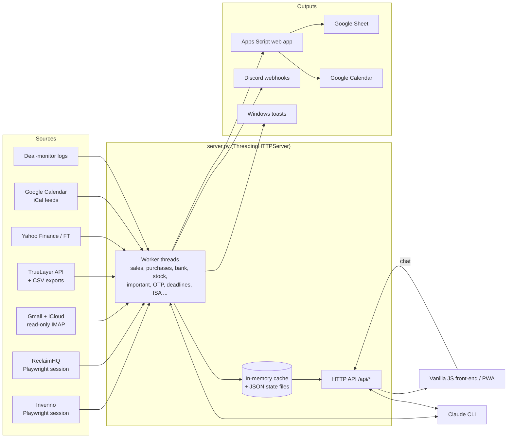

## Tech stack

- **Back end**: Python 3 standard library (`http.server`, `imaplib`, `email`, `urllib`, `threading`), Playwright (Chromium persistent contexts), `icalendar` + `recurring-ical-events`
- **Front end**: vanilla JavaScript, HTML and CSS (no framework, no build step), canvas effects, Web Speech API, service worker + web manifest
- **Integrations**: Invenno, Amazon SP-API, TrueLayer, ReclaimHQ, Keepa / SellerAmp links, Google Apps Script (Sheets + Calendar), Discord webhooks, Claude CLI
- **Platform**: Windows (Task Scheduler, WMI, toast notifications, `msvcrt` file locks)

## Engineering highlights

- **Cross-process browser profile lock.** Invenno uses single-use (rotating) refresh tokens. When the server and a one-off script opened the same session at once, the token rotated twice and the session was revoked. Every use of the profile now goes through one lock that combines a thread lock with an OS-level `msvcrt` file lock and all API calls run inside that one browser so the rotated token is always saved.
- **IMAP across providers, in parallel.** Inboxes are scanned concurrently with a thread pool while keeping `.env` order for de-duplication of forwarded copies. It handles Gmail-only fetch items (`X-GM-MSGID`, labels), iCloud returning `[None]` for empty searches, server-side `FROM` searches so busy inboxes do not hide codes, `BODY.PEEK` so nothing is marked as read and a Message-ID cache so each body is fetched once.
- **Content-hashed transaction IDs.** Overlapping statement exports would duplicate rows. Each CSV row gets an ID hashed from its content plus its position among identical rows, the largest copy across files wins and an alias table keeps IDs stable for rows already synced to the Google Sheet.
- **Prompt-injection-safe LLM extraction.** Emails are passed to the Claude CLI as JSON data with a system prompt that says never to follow instructions inside them, with all tools disabled, the user's own settings ignored and output parsed strictly as a JSON array. Edit mode only ever sees the user's own messages, never email or lead text.
- **Upsert-by-key Google Sheet sync.** The Apps Script reads columns by header name, updates rows by key, never deletes and never overwrites the user's own columns. Notes are two-way synced with last-writer-wins timestamps.
- **Fuzzy order matching.** Order emails in several languages are matched to Invenno purchases by token overlap, model-number tokens, quantity and date window, then to card payments by amount, merchant and FX-aware tolerances.
- **Self-healing uptime.** A health endpoint reports each source's last check and error state; the watchdog relaunches anything missing through WMI (independent of any terminal) and restarts a frozen server after two failed checks.

## Screenshots

All screenshots use the built-in demo mode (`python demo_server.py`): every figure, order and email is fake.

| Overview | Purchases pipeline |
|---|---|
| 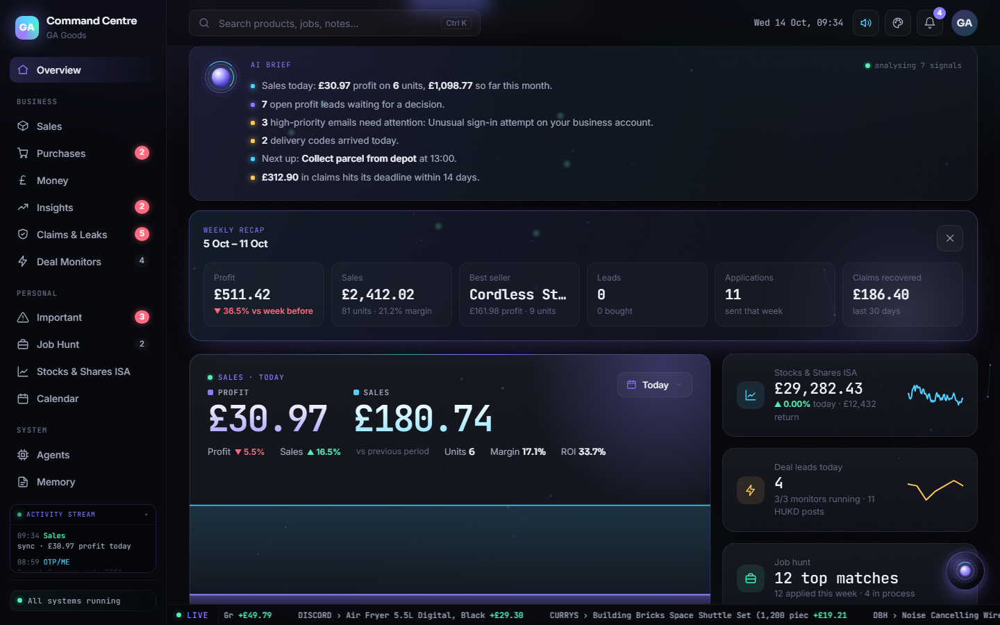 | 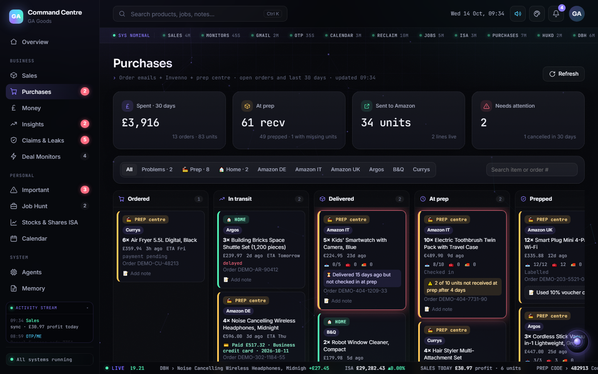 |
| **Money (bank ledger)** | **Insights** |
| 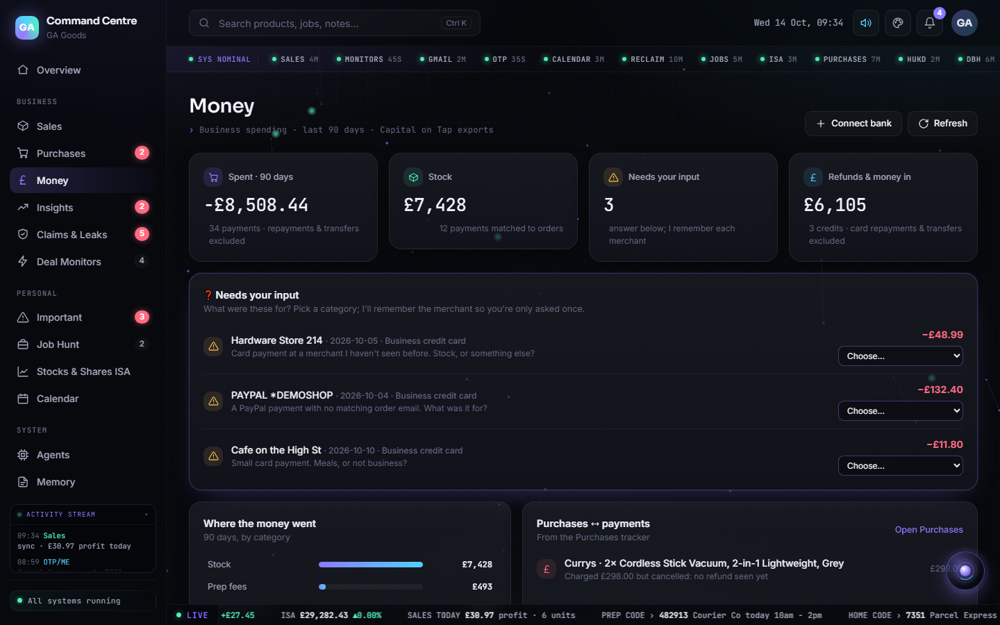 | 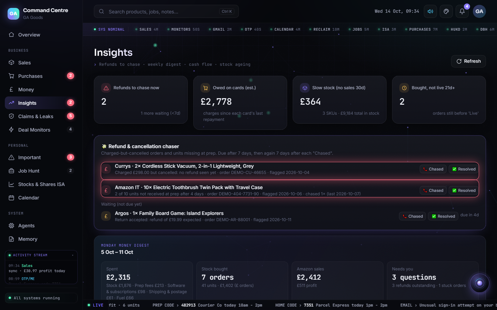 |
| **Sales** | **Important emails** |
| 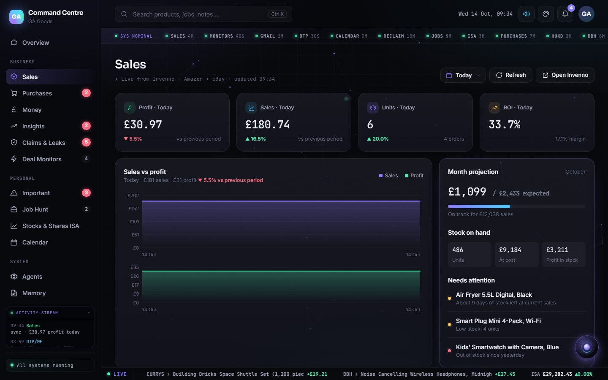 | 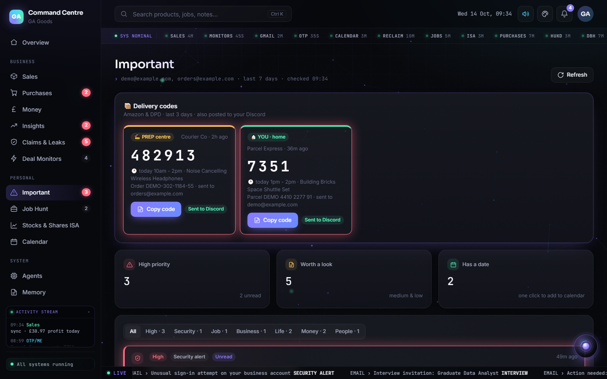 |
| **Deal monitors** | **AI chat** |
| 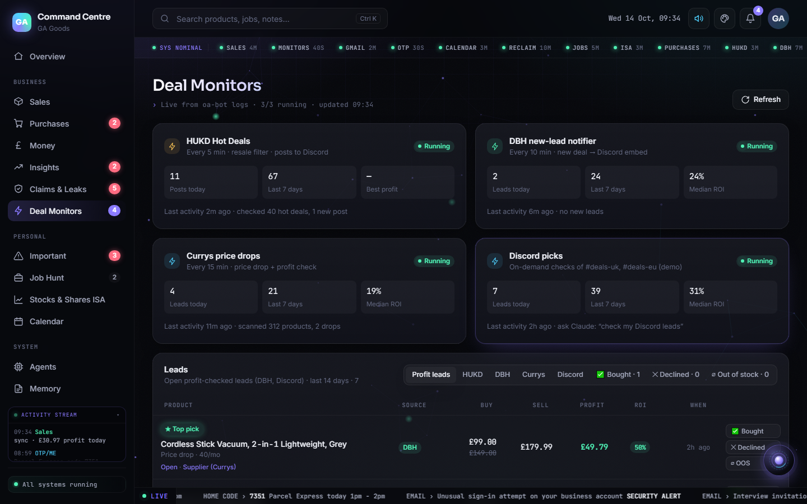 | 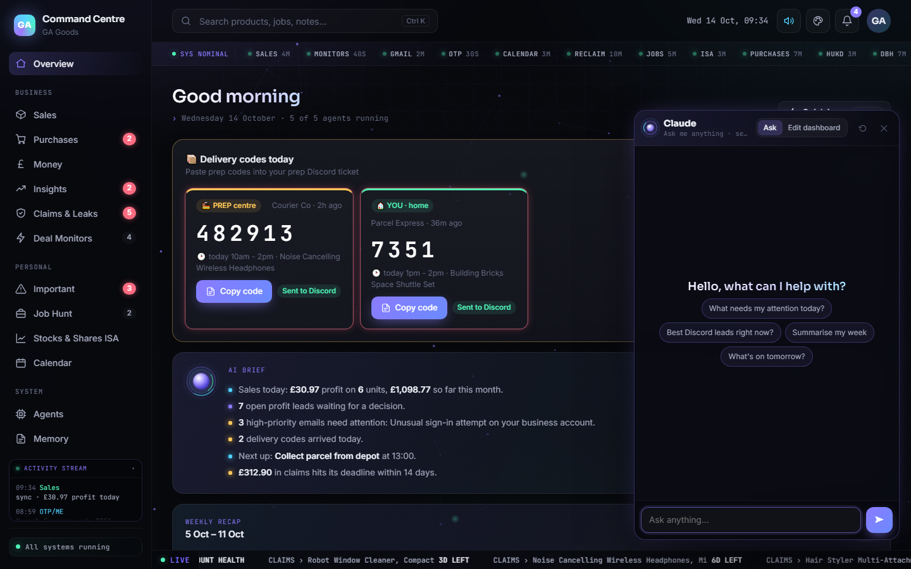 |
| **Stocks & Shares ISA** | **Calendar** |
| 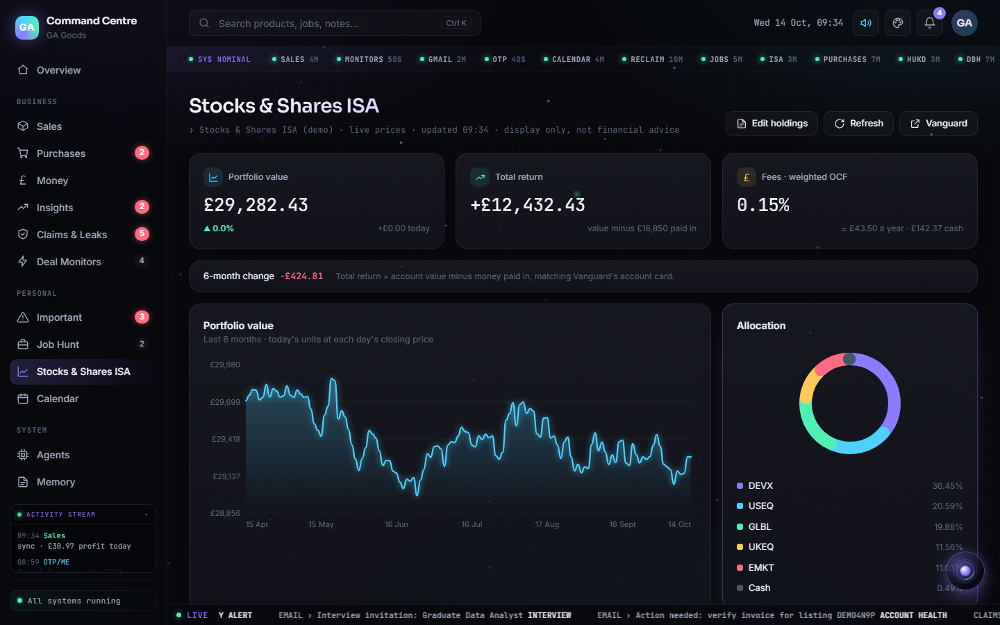 | 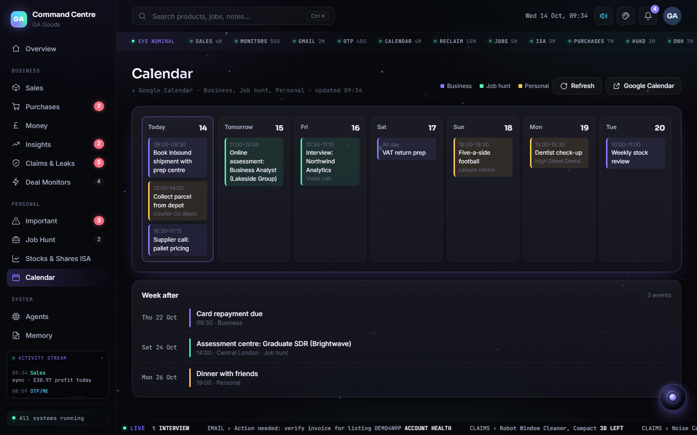 |

## Try the demo

You can run the whole dashboard with realistic but entirely fake data. No accounts, API keys, browser sessions or extra packages are needed, only Python 3:

```bash
python demo_server.py
```

Then open http://127.0.0.1:8799 (add `--open` to launch the browser for you). `demo_server.py` serves the same front-end from `app/` and answers every `/api/*` endpoint with invented products, orders, transactions, emails, events and jobs, generated relative to today's date so the charts look current. Buttons that would change something (notes, categories, "Chased", lead status, holdings) are accepted and ignored and the chat box replies that it is in demo mode. Press Ctrl+C to stop it.

## Setup

1. Install Python 3.12 or newer (Windows; developed on 3.14) and Node.js (optional, used for `node --check` in Edit mode).
2. Install the dependencies:
   ```
   pip install -r requirements.txt
   playwright install chromium
   ```
3. Copy `.env.example` to `.env` and fill in the keys for the features you want. Unset keys simply switch that feature off.
4. For the Google Sheet and Calendar sync, paste `purchases_sheet_script.gs` into the sheet's Apps Script editor, set `TOKEN` to the same value as `SHEET_WEBHOOK_TOKEN`, then deploy it as a web app.
5. Log in to the browser-based sources once: `python invenno.py --login` and `python reclaim.py --login` (or the `connect-*.bat` files).
6. Start the server:
   ```
   python server.py
   ```
7. Open http://127.0.0.1:8765

## Project structure

```
command-centre/
├── app/                      Front-end (index.html, app.js, chat-ui.js, fx.js, styles.css, data.js demo data, PWA files)
├── docs/screenshots/         Screenshots (demo data)
├── server.py                 HTTP server, worker threads and /api routes
├── demo_server.py            Demo mode: same front-end, fake data, port 8799, standard library only
├── invenno.py, spapi.py      Sales data (Invenno session, Amazon SP-API client)
├── purchases.py              Order emails -> purchases tracker, Sheet sync, Discord alerts
├── bank.py, ledger.py        TrueLayer + CSV import, categorisation, payment matching
├── insights.py, stock.py     Refund chaser, digest, cash flow, stock ageing
├── important.py, urgent.py   Email triage, Done state, urgent alerts
├── otp_watch.py              Delivery code watcher
├── deadlines.py              Email deadlines -> Google Calendar via the Claude CLI
├── chat.py                   Claude chat box (Ask and Edit modes)
├── calendar_feed.py, isa.py, jobs.py, monitors.py, reclaim.py
├── watchdog.py, discord_reminder.py
├── purchases_sheet_script.gs Google Apps Script for the Sheet and Calendar
├── start.bat, connect-*.bat  Windows launchers
├── .env.example, requirements.txt, LICENSE
```

## Security and privacy

- Mailboxes are opened **read-only** with app passwords; message bodies are fetched with `BODY.PEEK` so nothing is marked as read or changed.
- Bank access is read-only Open Banking through TrueLayer; the app never sees bank logins.
- All secrets live in `.env`; tokens, caches, statements and browser profiles stay on the local machine and are git-ignored.
- The server binds to `127.0.0.1` only. Remote access from a phone goes through Tailscale rather than an open port.
- Email and Discord text is always treated as data, never as instructions, when it reaches the LLM.

## Author

Ayodamope Akinyemi. Licensed under the [MIT License](LICENSE).
